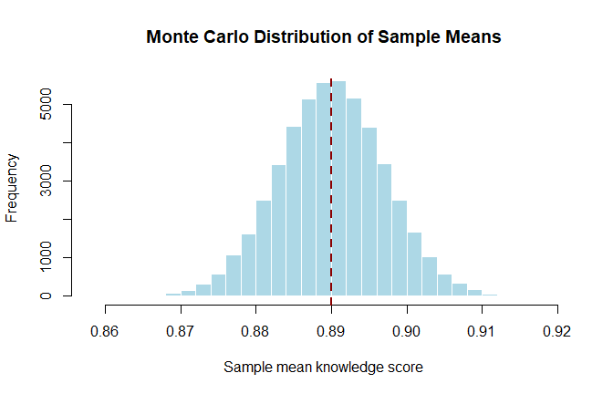

Monte Carlo Simulation in R
================
Sato Martin (<martinsato.sato38@gmail.com>)
2026-11-04

- [1. What is Monte Carlo
  simulation?](#1-what-is-monte-carlo-simulation)
- [2. Example 1: Probability from a normal
  distribution](#2-example-1-probability-from-a-normal-distribution)
- [3. Example 2: The basic simulation
  loop](#3-example-2-the-basic-simulation-loop)
- [4. Example 3: Coin flips](#4-example-3-coin-flips)
- [5. Example 4: Food-safety non-compliances
  (Poisson)](#5-example-4-food-safety-non-compliances-poisson)
- [6. Example 5: Sampling distribution of a
  mean](#6-example-5-sampling-distribution-of-a-mean)
- [7. Key takeaways](#7-key-takeaways)
- [Session information](#session-information)

# 1. What is Monte Carlo simulation?

Monte Carlo simulation estimates the likely outcomes of an uncertain
process. Instead of solving a problem with formulas, we generate many
random scenarios and look at what happens on average.

A simple analogy: to estimate how often a die lands on six, you could
work it out on paper, or you could roll it 10,000 times and count. Monte
Carlo is the second approach, done by a computer.

**The general procedure:**

1.  Define the model, for example a cost, risk, yield or exposure
    calculation.
2.  Assign a probability distribution to each uncertain input (normal,
    uniform, Poisson, triangular, and so on).
3.  Draw one random value for each input and compute the outcome.
4.  Repeat this thousands or millions of times.
5.  Summarise the outcomes with means, standard deviations, percentiles
    and probabilities.

The more repetitions we run, the closer the simulated answer gets to the
true value.

**Good practice used throughout:**

- `set.seed()` at the start of every simulation, so anyone can reproduce
  the exact results.
- Parameters stored in named variables at the top of each chunk, rather
  than hard-coded inside functions.
- Vectorised code where possible, since it is shorter and much faster
  than loops in R.
- A check against the theoretical answer whenever one exists.
- Only base R is used, so no extra packages are needed.

# 2. Example 1: Probability from a normal distribution

**Question:** If X follows a normal distribution with mean 1 and
standard deviation 10, what is the probability that X lies between 3 and
6?

``` r
set.seed(42)

n_sims <- 100000
mu     <- 1
sigma  <- 10

draws <- rnorm(n_sims, mean = mu, sd = sigma)

# Proportion of draws between 3 and 6
p_sim_normal <- mean(draws >= 3 & draws <= 6)

# Exact value for comparison
p_exact_normal <- pnorm(6, mu, sigma) - pnorm(3, mu, sigma)

c(simulated = p_sim_normal, exact = p_exact_normal)
```

    simulated     exact 
    0.1112600 0.1122028 

**Interpretation:** About 11.1% of values from this distribution fall
between 3 and 6. The exact probability is 0.1122, so the simulation is
very close. This shows that 100,000 draws is enough for a reliable
estimate.

> **How it works:** `draws >= 3 & draws <= 6` gives `TRUE` or `FALSE`
> for each draw. Because R treats `TRUE` as 1 and `FALSE` as 0, taking
> the `mean()` gives the share of draws that meet the condition.

# 3. Example 2: The basic simulation loop

This example shows the general structure of a Monte Carlo simulation
using a `for` loop. The loop makes each step visible, which helps when
the model becomes more complex.

``` r
set.seed(123)

n_sims  <- 100000
results <- numeric(n_sims)   # pre-allocate storage

for (i in seq_len(n_sims)) {
  # Step 1: draw a random input
  x <- rnorm(1, mean = 5, sd = 15)

  # Step 2: calculate the outcome (here, simply the draw itself)
  # Step 3: store the outcome
  results[i] <- x
}

summary_stats <- data.frame(
  Mean   = mean(results),
  SD     = sd(results),
  Min    = min(results),
  Q1     = quantile(results, 0.25, names = FALSE),
  Median = median(results),
  Q3     = quantile(results, 0.75, names = FALSE),
  Max    = max(results)
)

knitr::kable(summary_stats, digits = 3)
```

|  Mean |     SD |     Min |     Q1 | Median |     Q3 |    Max |
|------:|-------:|--------:|-------:|-------:|-------:|-------:|
| 5.015 | 14.996 | -56.981 | -5.053 |  5.014 | 15.129 | 69.842 |

**Interpretation:**

- The simulated mean (5.01) and standard deviation (15) are almost
  exactly the values we specified (5 and 15). The simulation behaves as
  expected.
- The mean and median are nearly equal, which reflects the symmetry of
  the normal distribution.
- The theoretical quartiles are -5.12 and 15.12, very close to the
  simulated ones.
- The minimum and maximum are extreme values. With 100,000 draws we
  expect a few values about four standard deviations from the mean, so
  these are not unusual.

> **Good practice:** `results <- numeric(n_sims)` creates the storage
> vector before the loop. Growing a vector inside a loop with `c()` is
> much slower. `seq_len(n_sims)` is a safer alternative to `1:n_sims`,
> because it also behaves correctly when `n_sims` is 0.

The same result can be produced in one vectorised line:
`results <- rnorm(n_sims, mean = 5, sd = 15)`.

# 4. Example 3: Coin flips

**Question:** If we flip a fair coin 10 times, what is the probability
of getting more than 3 heads?

This can be solved exactly with the binomial distribution, but suppose
we did not know that. We can simulate it instead by coding heads as 1
and tails as 0.

``` r
set.seed(2024)

n_sims  <- 100000
n_flips <- 10

# Each row is one experiment of 10 flips
flips <- matrix(
  sample(c(0, 1), size = n_sims * n_flips, replace = TRUE),
  nrow = n_sims
)

heads <- rowSums(flips)

p_sim_coin   <- mean(heads > 3)
p_exact_coin <- 1 - pbinom(3, size = n_flips, prob = 0.5)

c(simulated = p_sim_coin, exact = p_exact_coin)
```

    simulated     exact 
     0.828330  0.828125 

**Interpretation:** In about 83% of experiments of 10 flips, we see 4 or
more heads. The exact probability is 0.8281. Getting 3 or fewer heads is
fairly uncommon, at around 17%.

# 5. Example 4: Food-safety non-compliances (Poisson)

**Scenario:** Suppose the daily number of food-safety non-compliances
for a vendor follows a Poisson distribution with a mean of 2. What is
the probability of **3 or more non-compliances** on a given day?

``` r
set.seed(2026)

n_sims <- 1000000
lambda <- 2   # average non-compliances per day

non_compliances <- rpois(n_sims, lambda = lambda)

p_sim_pois   <- mean(non_compliances >= 3)
p_exact_pois <- 1 - ppois(2, lambda = lambda)

c(simulated = p_sim_pois, exact = p_exact_pois)
```

    simulated     exact 
    0.3232810 0.3233236 

**Interpretation:** There is about a **32.3% chance** that a vendor
records 3 or more non-compliances on a given day. Put differently, a
vendor with this average would have such a day roughly once every three
days. With one million repetitions, the simulated value (0.3233) is
almost identical to the exact value (0.3233).

> **Why the exact value is 1 − P(X ≤ 2):** “3 or more” is the opposite
> of “0, 1 or 2”, so we subtract the probability of those three outcomes
> from 1.

# 6. Example 5: Sampling distribution of a mean

Monte Carlo simulation is especially useful for understanding **sampling
uncertainty**: how much a sample mean would change if we repeated a
survey many times.

**Scenario:** We survey 61 informal food vendors and measure a
food-safety knowledge score from 0 to 1. Assume the true population mean
is 0.89 and the standard deviation is 0.055. If we repeated this survey
50,000 times, how much would the sample mean vary?

``` r
set.seed(61)

n_sims   <- 50000   # number of repeated surveys
n        <- 61      # vendors per survey
pop_mean <- 0.89
pop_sd   <- 0.055

sample_means <- numeric(n_sims)

for (i in seq_len(n_sims)) {
  vendor_scores   <- rnorm(n, mean = pop_mean, sd = pop_sd)
  sample_means[i] <- mean(vendor_scores)
}

summary(sample_means)
```

       Min. 1st Qu.  Median    Mean 3rd Qu.    Max. 
     0.8596  0.8853  0.8900  0.8900  0.8948  0.9192 

``` r
# Simulated vs theoretical standard error
se_sim    <- sd(sample_means)
se_theory <- pop_sd / sqrt(n)
c(simulated_se = se_sim, theoretical_se = se_theory)
```

      simulated_se theoretical_se 
       0.007046079    0.007042028 

``` r
# Middle 95% of sample means
interval_95 <- quantile(sample_means, c(0.025, 0.975))
interval_95
```

         2.5%     97.5% 
    0.8762554 0.9038661 

``` r
hist(
  sample_means,
  breaks = 40,
  main   = "Monte Carlo Distribution of Sample Means",
  xlab   = "Sample mean knowledge score",
  col    = "lightblue",
  border = "white"
)
abline(v = pop_mean, col = "darkred", lwd = 2, lty = 2)
```

<figure>

<figcaption aria-hidden="true">Monte Carlo distribution of sample means.
The dashed line marks the true population mean.</figcaption>
</figure>

**Interpretation:**

- **The sample mean is unbiased.** The average of all 50,000 sample
  means is 0.89, matching the true population mean of 0.89.
- **The spread is much smaller than for individual vendors.** Individual
  scores vary with a standard deviation of 0.055, but sample means vary
  with a standard error of only 0.007 (theory: 0.007). Averaging 61
  vendors cancels out much of the individual variation.
- **The distribution is bell-shaped and centred on 0.89.** This
  illustrates the Central Limit Theorem: sample means are approximately
  normally distributed.
- **Practical meaning:** If the true mean is 0.89, a survey of 61
  vendors will almost always produce a sample mean between about 0.876
  and 0.904. A result outside this range would suggest that the true
  mean is different from 0.89.

> **A note on the normal assumption:** The knowledge score is bounded
> between 0 and 1, but the normal distribution is not. Here this causes
> little problem, because with a mean of 0.89 and SD of 0.055, only
> about 2.3% of individual scores would exceed 1. For scores closer to
> the boundaries, a beta distribution would be a better choice.

# 7. Key takeaways

- Monte Carlo simulation replaces difficult maths with repeated random
  sampling.
- Accuracy improves as the number of repetitions increases.
- Always set a seed so results can be reproduced.
- Where an exact answer exists, compare against it to check that the
  simulation is correct.
- Choose input distributions that match the real data, for example its
  range, shape and whether it can be negative.

# Session information

``` r
sessionInfo()
```

    R version 4.4.2 (2024-10-31 ucrt)
    Platform: x86_64-w64-mingw32/x64
    Running under: Windows 10 x64 (build 19045)

    Matrix products: default


    locale:
    [1] LC_COLLATE=English_United States.utf8 
    [2] LC_CTYPE=English_United States.utf8   
    [3] LC_MONETARY=English_United States.utf8
    [4] LC_NUMERIC=C                          
    [5] LC_TIME=English_United States.utf8    

    time zone: Europe/Paris
    tzcode source: internal

    attached base packages:
    [1] stats     graphics  grDevices utils     datasets  methods   base     

    loaded via a namespace (and not attached):
     [1] compiler_4.4.2    fastmap_1.2.0     cli_3.6.2         tools_4.4.2      
     [5] htmltools_0.5.8.1 rstudioapi_0.19.0 yaml_2.3.8        rmarkdown_2.32   
     [9] knitr_1.50        xfun_0.57         digest_0.6.35     rlang_1.2.0      
    [13] evaluate_0.23    
